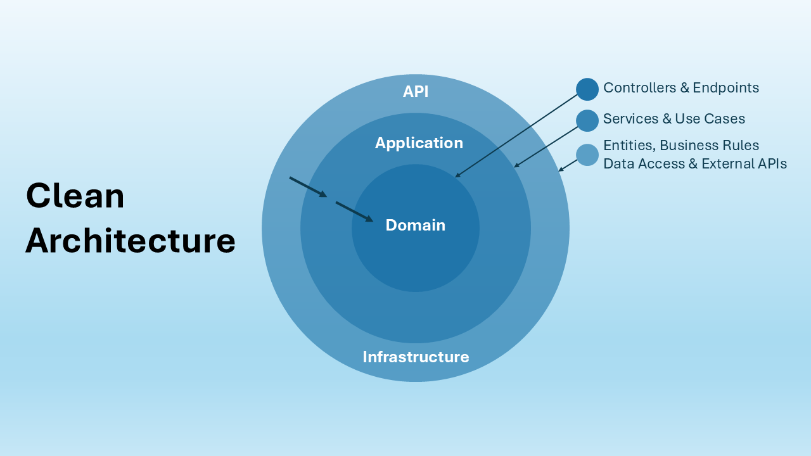
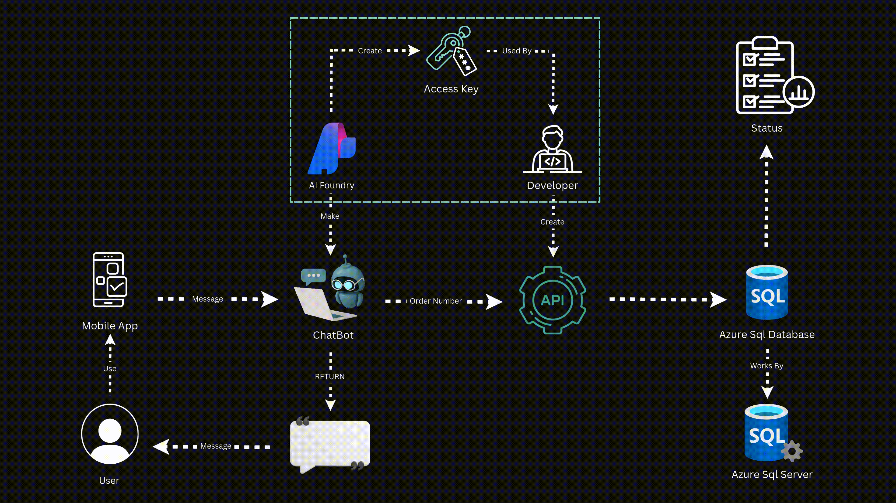

<div>
  
  
</div>
<br>
<h1 align="center">Chainly - Backend</h1>


Chainly is a modern supply chain management platform that leverages AI to help companies optimize suppliers, production, inventory, and deliveries.  
It provides demand forecasting, eco-friendly supplier recommendations, and real-time production monitoring with defect detection.  
Chainly also automates inventory tracking, sends low-stock alerts, and streamlines re-ordering for efficient end-to-end supply chain management.

## Features

- **Authentication & Authorization**
  - JWT-based authentication
  - Role-based access control
  - Fine-grained permissions system
  - Email verification

- **Supply Chain Management**
  - Order tracking and management
  - Production line monitoring
  - Material and supplier management
  - Real-time status updates

- **AI Integration**
  - Azure OpenAI integration
  - Intelligent insights
  - Production analytics
  - Quality control monitoring

- **Reporting & Analytics**
  - Comprehensive reporting system
  - Sales data analysis
  - Performance metrics
  - Custom report generation


## Project Structure

```
Chainly/
├── Chainly.API/                 # API layer
│   ├── Controllers/             # REST API endpoints
│   ├── Properties/              # Launch settings
│   ├── appsettings.json         # Configuration
│   └── Program.cs               # Application entry point
├── Chainly.Application/         # Application layer
│   ├── Configurations/          # Config classes
│   ├── DTOs/                    # Data transfer objects
│   ├── Extensions/              # Extension methods
│   └── Services/                # Business logic services
├── Chainly.Domain/              # Domain layer
│   ├── Constants/               # Enums and constants
│   └── Models/                  # Domain entities
└── Chainly.Infrastructure/      # Infrastructure layer
    ├── Extensions/              # Infrastructure extensions
    ├── Identity/                # Authentication
    ├── MailService/             # Email service
    ├── Migrations/              # EF Core migrations
    └── AppDbContext.cs          # Database context
```


## Architecture

Chainly follows Clean Architecture principles for maintainability, scalability, and testability:



### Clean Architecture Layers

1. **Domain Layer** (Chainly.Domain)
   - Core business entities
   - Business rules and logic
   - Interface definitions
   - No dependencies on other layers

2. **Application Layer** (Chainly.Application)
   - Implementation of use cases
   - Orchestration of domain entities
   - DTOs and interfaces
   - No dependencies on external concerns

3. **API Layer** (Chainly.API)
   - REST API endpoints
   - Request/Response handling
   - Authentication/Authorization
   - Dependency injection setup

4. **Infrastructure Layer** (Chainly.Infrastructure)
   - Data persistence (EF Core)
   - External service integration
   - Authentication implementation
   - Email services
   - Logging

## Deployment

Chainly is deployed on Azure App Service for scalable, reliable hosting, Also deployed the ChatBot on Azure AI Foundry.

### CI/CD with GitHub Actions

- Automated build, test, and deployment pipeline using GitHub Actions.
- On every push or pull request to the main branch, the workflow:
  - Restores dependencies
  - Builds and tests the solution
  - Publishes the API to Azure App Service

### ChatBot Deployment

- ChatBot For Customers Order Tracking Using AI Foundry on Azure
- Retrive Information From Database and reply to the customer

## API Documentation

API endpoints are documented using Scalar/OpenAPI:
- Production: https://chainly.azurewebsites.net/scalar

## Installation

1. Clone the repository:
   ```bash
   git clone https://github.com/ieee-victoris-4-0/Chainly.Backend.git
   ```

2. Install dependencies:
   ```bash
   dotnet restore
   ```

3. Create the database:
   ```bash
   dotnet ef database update --project Chainly.Infrastructure
   ```

## Development

Start the development server:
```bash
dotnet run --project Chainly.API
```

Update database:
```bash
dotnet ef database update --project Chainly.Infrastructure
```


<div>
  
  
</div>
